# 🎬 video-editor — Claude Code skill

[English](#english) · [ภาษาไทย](#ภาษาไทย) · [Test results gallery](#test-results-gallery)

## English

A Claude Code skill that edits video with ffmpeg and Python: finding the best moments in a livestream or long video, making vertical Shorts with subtitles, placing background music at the right moments, and building 2.5D animations from real photos synced to a narration.

Every rule in the skill comes from real experiments and a viewer's scores, not guesswork. The latest test clip scored **9.5/10**.

### 📦 Install

```
/plugin marketplace add phumrapee47/video-editor
/plugin install video-editor@video-editor
```

Update to the latest version:

```
/plugin marketplace update video-editor
```

**Manual install (personal skill):** copy `plugins/video-editor/skills/video-editor` to `~/.claude/skills/`, then call it with `/video-editor`.

### Requirements

Check a machine in one step: `python -I scripts/doctor.py` (it reports what is missing and how to fix it; it installs nothing). `pip install -r requirements.txt` covers the Python side. Titles and captions use bundled open-licence fonts (`assets/fonts`: Kanit, Playfair Display, Anton, SIL OFL), so edits look the same on Windows, macOS and Linux. Regression tests: `python -I tests/run_tests.py` (generated media only, ~20 s); they also run on every push (GitHub Actions).

- **ffmpeg** (tested with 9.0.1), runnable from the command line
- **Python 3.11** with `numpy` and `Pillow`
- **yt-dlp** to fetch video metadata and subtitles from YouTube
- **rembg** (`pip install "rembg[cpu]"`) to remove photo backgrounds (downloads its model on first use)
- **Blender 4.2+** (optional, tested with 5.2) for 3D product ads; Cycles uses the GPU when there is one
- **faster-whisper** (optional) for English transcription with word timestamps. For Thai use ElevenLabs Scribe through the **Creative Claw** plugin (paid credits, about 2 credits per 2 minutes)

### What it does

**1. 2.5D animation from a narration**
- Storyboards the narration with a shot change about every 3 seconds, landing visuals on key words
- Finds freely licensed real photos on Wikimedia Commons, removes backgrounds, and keeps the credits
- Layers images in depth, grades every photo to one look, and adds real moving atmosphere (clouds, smoke, ash)
- Camera shake and sound effects only where the story is tense or exciting; explainer diagrams and call-outs; whip-pan transitions
- Checks that the hero subject is never cropped (`scripts/check_cutout.py`) and sends a preview before the full render
- Narration from the user's own recording or an AI voice (ElevenLabs through the Creative Claw plugin, or free edge-tts), one file per line, with Thai years and numbers written out so the voice reads them right
- Swaps the voice of a finished edit without re-tuning it: `scripts/retime.py` maps every visual, effect and music cue from the old voice's timing onto the new one

**2. Highlights from livestreams or long videos, cut into short clips**
- Keeps storytelling, interaction with people, showing something, and punchlines; drops dead air and aimless walking
- Uses the transcript, loudness, and YouTube's replay heatmap to find candidates, then checks the frames
- Makes 9:16 vertical clips with subtitles and loudness set per style

**3. Music and sound**
- Narrated documentaries and 2.5D animations: a soft music bed under the whole narration, about 11 dB below the voice, changing with the mood
- Vlogs and streams: no music while people talk; music fades in only during scenery or whatever the camera is showing, and fades out before speech returns (ducked on subtitle timestamps)
- Picks the music genre from the setting, and always runs a level calibration before asking a listener to judge

**4. Basic editing**
- Cut, join, crop, speed change, subtitles, loudness, export
- Orders several clips by their recording timestamps (`scripts/order_clips.py`), then asks the user to confirm
- One JSON edit plan renders a whole footage edit: clips, transitions, Thai-safe titles, voice, ducked music, effects, subtitles, loudness (`scripts/edit_plan.py`, `--preview` first)
- Checks every video before it is sent: format and colour range, loudness and true peak, black or frozen picture, silence, subtitle timing and width, plus a contact sheet (`scripts/qa_check.py`)
- Renders photo-animation frames on all CPU cores, about 6x faster (`scripts/render_frames.py`)

**5. Podcast and interview Shorts (one command)**
- `scripts/podcast_short.py`: long talk -> vertical Short, stopping at three approval gates (picked lines, B-roll downloads, preview)
- Picks a self-contained, on-topic answer from the transcript (skips the host's questions and sign-offs), cuts on word edges
- Topic card intro, persistent headline, reframing that follows the speaker, split screen for two-shots, punch-in every ~3 s
- Word-stack captions in mixed type (key word big, bold italic serif, colour per phrase; numbers in red)
- Huge key words behind the person (person mask per frame), B-roll with the speaker in a circle bubble
- Key words and B-roll found automatically (`pick_moments.py`, `find_broll.py`: free-licence Wikimedia Commons only, downloads only after approval)
- Several Shorts from one long video: `scripts/podcast_batch.py` picks the best separate threads; titles and approvals for every clip live in one `batch.json`
- Platform safe zones: every vertical render is checked against the TikTok / Reels / Shorts interface (top tabs, right-hand buttons, bottom caption area) with a shaded check sheet (`scripts/safe_zones.py`)
- Thai word-stack captions: `scripts/thai_words.py` cuts Scribe's Thai characters into timed words (pythainlp), then the same stack style as English (lines packed by visible width, split names kept together)
- Follows whoever is talking in a two-shot (`reframe.py --speaker order|cut`, no model: mouth and jaw motion per speech turn): split screen with the speaker in the lower panel, or a close-up of the speaker
- Sound design: synthesised effect kit (whoosh, pop, riser, impact...; no downloads) placed where the picture changes, levels set against the speech (`scripts/sound_design.py`)
- Brand kit: one `brand.json` for fonts, accent colours, grade, corner logo, end card and effect level (`scripts/brand.py`)
- Music by mood: scan a music folder once, read the edit's mood from its words and titles, pick the closest track (`scripts/music_mood.py`)
- Free sound library: catalogue of 1,700+ CC BY / CC0 tracks and place recordings (Kevin MacLeod, Scott Buckley, Wikimedia Commons) with tags and credits; audio fetched on request into `~/.video-editor/sounds`, credits written for every render (`scripts/sound_library.py`)
- Travel and vlog montages from raw footage (`scripts/montage.py`): best moments, story order, cuts in beats, travel titles (pin, poem, spaced, stamp); the place's own sound first (YAMNet hears waterfalls, waves, birds, markets: `scripts/place_sound.py`), soft music chosen from the pictures and auditioned by ear (`scripts/music_audition.py`), -16 LUFS
- Built from a study of 21 reference podcast Shorts (`references/podcast-shorts.md`), version by version (v2 -> v10)

**6. Other genres**
- Product/ad: best moments by picture (`find_shots.py`), cuts on the music's bar grid (`music_beats.py`)
- **3D product ads** (Blender, headless): `ad_concept.py` plans the concept from what the product can do (a can opens, a bag tears, a filled bar snaps) and what its ingredient can do (a yuzu is split, juice sprays) -> beat board; `blender_product_ad.py` renders the shots: real 3D fruit with pored peel and cut flesh (`ad_fruit.py`), a can built to a 330 ml blueprint with lid, pull tab and Geometry Nodes condensation (`ad_can.py`), juice strands, CO2 mist, ice; shots split, drops, top pop, zero-G, hero; EEVEE previews, Cycles finals; mood families (luxury / fresh / tech / clean) choose light, motion, type and music (`references/ad-3d.md`)
- **3D ads from the user's product photo** (`ad_pipeline.py`): a brief file (product, photo, mood family, length, approved copy) -> `product_from_photo.py` rebuilds the product in 3D (silhouette -> profile, cap, unwrapped label, brand colours) -> shapes can, bottle or any round product, box, pouch, filled bar, each with what it does (open, twist the cap, tear the bag, snap the bar with the filling stretching) -> four approval gates: storyboard sheet, animatic, EEVEE preview, Cycles look + time estimate; shots last whole beats of the music and every physical event lands on a beat; renders resume
- **Design before building** (`ad_design.py`, `ad_look.py`): every shot gets a camera move from a 14-move vocabulary (orbit, spiral, crane, dolly zoom, whip-in, rack focus, macro slide...) chosen with variety rules (no repeated move or shot size side by side, at least one signature move, the mood family's taste), a transition (whip blur, flash, dissolve, glitch...), and the ad a living background (light pools and bokeh, haze and gold glints, neon grid, window-light shadows), decoration in depth and a motion style (bouncy / smooth / snappy); the storyboard becomes a design board with the moves drawn on each frame; `--variant N` for another design
- **Light and finish per mood**: a light rig per family (fresh high-key, luxury gold rims and a streak, tech neon rims, clean big soft top light) and a finishing pass on every render and storyboard still (highlight glow, lens fringe, vignette, grain, grade); brushed aluminium, bare-metal areas on can labels (`--label-metal auto`), embossed bars; music-led mixes are glued before loudness normalisation so dense tracks still reach -14 LUFS
- **Ads that sell**: a `performance` structure (hook, benefit, proof, demo, offer, call to action - also on the hero shot) or a `brand` film; an AI voiceover that says the brand early (edge-tts, Thai or English), a sonic logo made from the brand name, the brand kit's fonts and logo, callouts that point at the 3D product where there is room; an ABCD check at the gates (product and hook by 3 s, brand seen and said by 5 s, calls to action, readable text, works muted); hook variants for testing (`ad_pipeline.py variants`)
- **The cut and liquids**: the fruit cut shows a steel blade and a seam of light running down the skin, juice beads well up along it, juice films stretch between the halves and tear, mist and pulp fly, the camera jolts on the hit; a `crown` shot drops the product into its own drink (crown splash that frames the label, ripple rings, milk / coffee / juice colours); a seamless studio sweep instead of a floor and a wall, and a contact shadow under hovering products; the brief can pick the shots (`board`)
- Screen-recording tutorials: zoom to the action, fast-forward waiting (`screen_focus.py`)
- Animated titles (pop, punch, slide, word by word), accent words, topic cards, text-only cards

### Test history, version by version

Every version was tested on real material before it was pushed, and the user scored or judged the result. Links marked ▶
open the result video (GitHub release [`test-results`](https://github.com/phumrapee47/skills-video-editor/releases/tag/test-results));
the [gallery](#test-results-gallery) at the end shows frames from each. Tests on other creators' footage (livestream
highlights, travel vlogs, 2D ads cut from YouTube clips) stay on the test machine: their results are described here,
not shown.

**2.5D animation from narration**

| Version | What was tested | Result |
|---|---|---|
| v1 | geometric shapes in Blender (Roro Jonggrang) | Rejected: "not pretty at all", use real photos |
| v2 | real photo cut-outs, layered | 6/10: the whole clip shook, too much empty space |
| v3 | mood-based shake, layered temples, mood sound | 8/10, passed; the sky was still generated, not a photo · ▶ Roro Jonggrang demo below |
| v4 rules | Pompeii clip | **9.5/10**: "understands the mood and context"; minus 0.5 for cropping the hero subject · ▶ Pompeii demo |
| 1.1-1.2 | own Thai script, AI voice, music bed, Thai subtitles; Thai tone marks shaped by libass | ▶ Ayutthaya demo; dropped tone marks (นั่ง drawn as นัง) found and fixed in the demo titles |

**Editing, music and highlights**

| Version | What was tested | Result |
|---|---|---|
| 1.0 | ducking music under speech | Subtitle-timestamp ducking beat a sidechain compressor by ear; music 20 dB under speech is inaudible, 10-15 dB audible |
| 1.0 | highlight finder on livestreams | "Good enough"; reading the mood from speech first fixed the genre labels |
| 1.2 | edit plans + QA (loudness, true peak, black or frozen picture, Thai subtitle width) | Frames render about 6.5x faster on all cores; QA runs after every render |
| 1.8 | travel montages (Cape Town, Osaka, a cafe) | v1-v2 rejected ("the music doesn't fit the scenes, too loud"); v3 with calm jazz, the place's own sound first and -16 LUFS was liked ("easy on the ear, smooth") |

**Shorts from interviews and podcasts** (source: The Royal Society's interview with Hannah Cloke, CC BY 3.0)

| Version | What was tested | Result |
|---|---|---|
| genre round 1 | product ad, screen tutorial, interview Short | 7/10 (flat titles), **9.5/10**, 9/10 ("cut very well, zooms follow the person") -> rule: titles must move · [▶ tutorial](https://github.com/phumrapee47/skills-video-editor/releases/download/test-results/tutorial-screen-focus.mp4) |
| 1.3 | study of 21 reference Shorts, then 9 rounds on one clip: headline, punch-ins, word-stack captions, B-roll with a speaker bubble that follows the face, huge words behind the person, moments and B-roll picked automatically | Picture changes per 10 s: 1.7 -> 4.7; each round's fix is in `references/podcast-shorts.md` |
| 1.4 | bundled fonts, `doctor.py`, regression tests, CI | 10 tests; they caught an import bug on the first run |
| 1.5 | several Shorts from one video, platform safe zones | Safe-zone hits on the test Short 38 -> 0; a broken sign-off filter found and fixed · [▶ batch Short](https://github.com/phumrapee47/skills-video-editor/releases/download/test-results/short-batch-heat.mp4) |
| 1.6 | follow the speaker in two-shots, Thai word-stack captions | [▶ two-shot](https://github.com/phumrapee47/skills-video-editor/releases/download/test-results/short-two-shot-follow.mp4) · [▶ Thai captions](https://github.com/phumrapee47/skills-video-editor/releases/download/test-results/short-thai-word-stack.mp4) |
| 1.7 | sound design, brand kit, music by mood | [▶ interview Short with sound design](https://github.com/phumrapee47/skills-video-editor/releases/download/test-results/short-interview-flood.mp4) · [▶ brand kit](https://github.com/phumrapee47/skills-video-editor/releases/download/test-results/short-brand-kit.mp4) (made-up brand "Flood Lab") |

**3D product ads** (made-up brands LUMA, MOLTO, VOLT; every object built by the skill's Blender scripts)

| Version | What was tested | Result |
|---|---|---|
| 1.9 v1 | flat fruit pictures, simple can | OK as a first round; the user set the bar: "the skill must think up the design itself" · [▶ v1](https://github.com/phumrapee47/skills-video-editor/releases/download/test-results/ad3d-luma-v1.mp4) |
| 1.9 v2-v3 | real 3D yuzu sliced open with juice strands; the can opens; what the product can do | [▶ v2](https://github.com/phumrapee47/skills-video-editor/releases/download/test-results/ad3d-luma-v2.mp4) · [▶ v3](https://github.com/phumrapee47/skills-video-editor/releases/download/test-results/ad3d-luma-v3.mp4) |
| 1.9 v4 | can built to a 330 ml blueprint, condensation, Cycles | ▶ LUMA v4 demo below |
| 1.10 | one shot list, approval gates, shots locked to the music's beats | [▶ EEVEE preview](https://github.com/phumrapee47/skills-video-editor/releases/download/test-results/ad3d-luma-pipeline.mp4) |
| 1.11 | the product rebuilt from a photo; bar, pouch, box shapes; twist, tear, snap | [▶ MOLTO bar snaps](https://github.com/phumrapee47/skills-video-editor/releases/download/test-results/ad3d-molto-bar-snap.mp4) |
| 1.12 | design pass: camera moves, transitions, living backgrounds | [▶ animatic](https://github.com/phumrapee47/skills-video-editor/releases/download/test-results/ad3d-luma-design-pass.mp4) |
| 1.13 | light per mood, finishing, materials, loudness for music-led ads | [▶ VOLT, tech mood](https://github.com/phumrapee47/skills-video-editor/releases/download/test-results/ad3d-volt-tech.mp4); on a dense music-led test ad (not shown) the loudness glue lifted -16.8 to -15.3 LUFS (pass) |
| 1.14 | performance structure, AI voiceover, sonic logo, ABCD check, hook variants | ABCD check all PASS · [▶ animatic](https://github.com/phumrapee47/skills-video-editor/releases/download/test-results/ad3d-luma-performance.mp4) |
| 1.15 | the user: the cut and the callouts looked "too easy" -> study of studio work -> blade, seam of light, juice films, crown splash, seamless set | [▶ animatic](https://github.com/phumrapee47/skills-video-editor/releases/download/test-results/ad3d-luma-crown.mp4) |

Regression tests grew from 10 (1.4) to 32 (1.15); GitHub Actions runs them on every push (Blender tests skip there).

### Demos

The videos in `demos/` are real results from the tests. In the Pompeii and Roro Jonggrang demos **the narration and subtitles were removed** because the narration belongs to the original creator; what remains is the picture, on-screen text, and sound effects. The Ayutthaya demo has its own script, an AI voice, a music bed and Thai subtitles.

- [`demos/pompeii_demo.mp4`](demos/pompeii_demo.mp4): Pompeii, bodies frozen in time (85 s)
- [`demos/roro_jonggrang_demo.mp4`](demos/roro_jonggrang_demo.mp4): the legend of Roro Jonggrang (81 s)
- [`demos/ayutthaya_demo.mp4`](demos/ayutthaya_demo.mp4): the Buddha head in the tree roots, Wat Mahathat, Ayutthaya (137 s, AI narration in Thai)
- [`demos/luma_v4_demo.mp4`](demos/luma_v4_demo.mp4): 3D ad for LUMA Yuzu, a made-up drink (17 s, 9:16): the yuzu is slashed and the can rises out of it, condensation macro, top-down can opening, zero-G with ice, hero

Credits for every photo, footage clip, sound, and music track are in [`demos/CREDITS.md`](demos/CREDITS.md). The animation demos are released under CC BY-SA 4.0, as required by the source photos; the LUMA demo under CC BY 4.0. More result videos, one or more per version, are on the [`test-results` release](https://github.com/phumrapee47/skills-video-editor/releases/tag/test-results) (see the table above and the gallery).

### Limits

- Claude cannot hear. Music fit, mix balance, and humor need a human listener.
- Whisper small cannot transcribe Thai. ElevenLabs Scribe (Creative Claw `transcribe`) can: on a 130 s Thai recording it found all 17 script lines within 0.08 s of hand-tuned times, and `scripts/align_script.py` turns that into line timing and subtitles. It costs credits; YouTube Thai auto captions remain the free fallback (2-3 s chunks).
- YouTube videos may include an AI-dubbed audio track; choose the original track (see `references/ffmpeg-recipes.md`).
- Other people's audio or video is for local testing only. Publishing it needs permission; credit alone is not enough.

---

## ภาษาไทย

Skill สำหรับ Claude Code ที่ตัดต่อวิดีโอด้วย ffmpeg และ Python ตั้งแต่หาช่วงเด็ดในไลฟ์หรือคลิปยาว ทำ Shorts แนวตั้งพร้อมซับ วางเพลงประกอบให้ถูกจังหวะ ไปจนถึงสร้างแอนิเมชัน 2.5D จากภาพจริงตามเสียงบรรยาย

กฎทุกข้อใน skill มาจากการทดลองจริงและการให้คะแนนของคนดู ไม่ได้มาจากการเดา คลิปทดสอบล่าสุดได้ **9.5/10**

### 📦 ติดตั้ง

```
/plugin marketplace add phumrapee47/video-editor
/plugin install video-editor@video-editor
```

อัปเดตเป็นเวอร์ชันล่าสุด:

```
/plugin marketplace update video-editor
```

**ติดตั้งแบบ manual (personal skill):** คัดลอกโฟลเดอร์ `plugins/video-editor/skills/video-editor` ไปไว้ที่ `~/.claude/skills/` แล้วเรียกด้วย `/video-editor`

### สิ่งที่ต้องมี

ตรวจเครื่องในคำสั่งเดียว: `python -I scripts/doctor.py` (บอกว่าขาดอะไรและแก้อย่างไร ไม่ติดตั้งอะไรเอง) ฝั่ง Python ใช้ `pip install -r requirements.txt` ตัวหนังสือในคลิปใช้ฟอนต์ลิขสิทธิ์เปิดที่แนบมา (`assets/fonts`: Kanit, Playfair Display, Anton, SIL OFL) หน้าตาจึงเหมือนกันทั้ง Windows, macOS และ Linux ชุดทดสอบ: `python -I tests/run_tests.py` (ใช้วิดีโอที่สร้างขึ้นเอง ราว 20 วินาที) และรันอัตโนมัติทุก push บน GitHub Actions

- **ffmpeg** (ทดสอบกับ 9.0.1) สั่งรันจาก command line ได้
- **Python 3.11** พร้อม `numpy` และ `Pillow`
- **yt-dlp** สำหรับดึงข้อมูลคลิปและซับจาก YouTube
- **rembg** (`pip install "rembg[cpu]"`) สำหรับตัดฉากหลังของภาพ (โหลดโมเดลครั้งแรกที่ใช้)
- **faster-whisper** (ไม่บังคับ) ถอดเสียงภาษาอังกฤษพร้อมเวลาระดับคำ ส่วนภาษาไทยใช้ ElevenLabs Scribe ผ่านปลั๊กอิน **Creative Claw** (ใช้เครดิต ราว 2 เครดิตต่อ 2 นาที)

### ทำอะไรได้บ้าง

#### 1. แอนิเมชัน 2.5D จากเสียงบรรยาย
- วางสตอรีบอร์ดตามเสียงบรรยาย เปลี่ยนช็อตทุกราว 3 วินาที ผูกภาพกับคำสำคัญ
- หาภาพจริงที่ใช้ได้ตามลิขสิทธิ์จาก Wikimedia Commons ตัดฉากหลัง และเก็บเครดิตให้
- ซ้อนชั้นมีมิติ ปรับสีชุดเดียวทั้งคลิป ใส่บรรยากาศเคลื่อนไหวจริง (เมฆ ควัน เถ้า)
- ภาพสั่นและเสียงประกอบเฉพาะช่วงที่มีอารมณ์ มีแผนภาพอธิบายและเส้นชี้ เปลี่ยนฉากแบบกวาดกล้อง
- ตรวจว่าวัตถุหลักไม่ถูกครอปขาด (`scripts/check_cutout.py`) และส่งพรีวิวก่อนเรนเดอร์เต็ม
- เสียงบรรยายใช้ได้ทั้งเสียงที่ผู้ใช้อัดเองและเสียง AI (ElevenLabs ผ่านปลั๊กอิน Creative Claw หรือ edge-tts ที่ฟรี) ทำทีละบรรทัด และเขียนปีหรือตัวเลขเป็นคำอ่านให้เสียงอ่านถูก
- เปลี่ยนเสียงพากย์ของคลิปที่ทำเสร็จแล้วได้โดยไม่ต้องจูนใหม่: `scripts/retime.py` แปลงเวลาของภาพ เอฟเฟกต์ และเพลงจากเสียงเดิมไปตามเสียงใหม่

#### 2. หาช่วงเด็ดจากไลฟ์หรือคลิปยาว แล้วทำคลิปสั้น
- เก็บเฉพาะการเล่าเรื่อง ปฏิสัมพันธ์ การโชว์ของ และมุก ตัดช่วงเงียบและการเดินเรื่อยๆ
- ใช้บทพูด ความดังเสียง และ heatmap ของ YouTube หาจุดเริ่ม แล้วดูภาพยืนยัน
- ทำแนวตั้ง 9:16 พร้อมซับ และปรับระดับเสียงตามสไตล์

#### 3. เพลงและเสียง
- สารคดีหรือแอนิเมชัน 2.5D ที่มีเสียงบรรยาย: ใส่เพลงเบาๆ ใต้เสียงบรรยายตลอดคลิป เบากว่าเสียงพูดราว 11 dB และเปลี่ยนตามอารมณ์
- vlog และไลฟ์: ไม่มีเพลงตอนคนพูด เพลงค่อยๆ เข้ามาเฉพาะตอนโชว์วิวหรือสิ่งที่กล้องชี้ แล้วลดลงก่อนเสียงพูดกลับมา (ลดตามเวลาของซับ)
- เลือกแนวเพลงตามสถานที่ และทดสอบระดับเสียงก่อนให้คนฟังตัดสินทุกครั้ง

#### 4. งานตัดต่อพื้นฐาน
- ตัด ต่อ ครอป เร่งความเร็ว ใส่ซับ ปรับความดัง export
- เรียงหลายคลิปตาม timestamp ในไฟล์ (`scripts/order_clips.py`) แล้วให้ผู้ใช้ยืนยัน
- ไฟล์แผนตัดต่อ JSON ไฟล์เดียวเรนเดอร์ได้ทั้งคลิป: คลิป ทรานซิชัน หัวข้อภาษาไทยที่วรรณยุกต์ครบ เสียงพากย์ เพลงที่ลดตอนพูด เอฟเฟกต์ ซับ และความดัง (`scripts/edit_plan.py` ทำ `--preview` ก่อน)
- ตรวจทุกคลิปก่อนส่ง: รูปแบบไฟล์และช่วงสี ความดังและเสียงแตก จอดำหรือภาพนิ่ง เสียงเงียบ เวลาและความกว้างของซับ พร้อมภาพสรุปทั้งคลิป (`scripts/qa_check.py`)
- เรนเดอร์ภาพแอนิเมชันพร้อมกันทุกคอร์ เร็วขึ้นราว 6 เท่า (`scripts/render_frames.py`)

#### 5. คลิปสั้นจากพอดแคสต์และสัมภาษณ์ (คำสั่งเดียว)
- `scripts/podcast_short.py`: คลิปยาว → Short แนวตั้ง หยุดถาม 3 จุด (ช่วงที่เลือก, ไฟล์ B-roll ที่จะดาวน์โหลด, ตัวอย่าง)
- เลือกคำตอบที่จบในตัวและตรงหัวข้อจาก transcript (ข้ามคำถามและคำปิดของพิธีกร) ตัดตรงขอบคำ
- การ์ด topic ตอนเปิด, หัวข้อค้างทั้งคลิป, ครอปตามคนพูด, แบ่งจอบน-ล่างสำหรับสองคน, ซูมเข้า-ออกทุกราว 3 วินาที
- ซับแบบกองคำ ตัวอักษรผสม (คำเด่นใหญ่ serif ตัวหนาเอียง สีเปลี่ยนตามวลี ตัวเลขสีแดง)
- คำใหญ่อยู่หลังคน (ตัดคนออกทุกเฟรม), B-roll พร้อมหน้าคนพูดในวงกลม
- หาคำสำคัญและ B-roll อัตโนมัติ (`pick_moments.py`, `find_broll.py`: ใช้เฉพาะไฟล์ลิขสิทธิ์เปิดจาก Wikimedia Commons ดาวน์โหลดหลังอนุมัติเท่านั้น)
- หลายคลิปจากวิดีโอยาวเดียว: `scripts/podcast_batch.py` เลือกช่วงที่ดีที่สุดหลายช่วงที่ไม่ซ้อนกัน ชื่อคลิปและการอนุมัติทุกคลิปอยู่ใน `batch.json` ไฟล์เดียว
- ขอบปลอดภัยของแพลตฟอร์ม: ทุกคลิปแนวตั้งถูกเช็กว่าข้อความไม่ทับแท็บบน ปุ่มขวา และแถบข้อความล่างของ TikTok / Reels / Shorts พร้อมภาพแรเงาให้ดู (`scripts/safe_zones.py`)
- ซับไทยแบบกองคำ: `scripts/thai_words.py` ตัดคำไทยจากผลถอดเสียง Scribe พร้อมเวลา (pythainlp) แล้วใช้สไตล์กองคำแบบเดียวกับภาษาอังกฤษ (จัดบรรทัดตามความกว้างจริง ชื่อที่ถูกตัดเป็นชิ้นอยู่บรรทัดเดียวกัน)
- ตามคนพูดในภาพสองคน (`reframe.py --speaker order|cut` ไม่ใช้โมเดล ดูการขยับปากและกรามในแต่ละช่วงพูด): แบ่งจอโดยให้คนพูดอยู่จอล่าง หรือตัดไปภาพใกล้ของคนพูด
- เสียงประกอบอัตโนมัติ: สังเคราะห์เสียง whoosh, pop, riser, impact เอง (ไม่ต้องดาวน์โหลด) วางตรงจุดที่ภาพเปลี่ยน ระดับเสียงเทียบกับเสียงพูด (`scripts/sound_design.py`)
- Brand kit: ไฟล์ `brand.json` ไฟล์เดียวกำหนดฟอนต์ สี โทนภาพ โลโก้มุมจอ การ์ดปิดท้าย และระดับเสียงเอฟเฟกต์ (`scripts/brand.py`)
- เลือกเพลงตามอารมณ์: วิเคราะห์คลังเพลงครั้งเดียว อ่านอารมณ์คลิปจากคำพูดและหัวข้อ แล้วเลือกเพลงที่ใกล้ที่สุด (`scripts/music_mood.py`)
- คลังเสียงฟรี: รายชื่อเพลงและเสียงสถานที่กว่า 1,700 รายการ (CC BY / CC0 จาก Kevin MacLeod, Scott Buckley, Wikimedia Commons) พร้อมแท็กและเครดิต ดาวน์โหลดเมื่อต้องใช้ และเขียนเครดิตให้ทุกคลิป (`scripts/sound_library.py`)
- คลิปท่องเที่ยว/vlog จากฟุตเทจดิบ (`scripts/montage.py`): คัดช่วงดี เรียงเรื่องเล่า ตัดตามจังหวะเพลง ตัวหนังสือแบบท่องเที่ยว ให้เสียงสถานที่มาก่อน (YAMNet ฟังเสียงน้ำตก คลื่น นก ตลาด) เลือกเพลงนุ่มๆ จากภาพแล้วให้คนเลือกด้วยหูจาก audition ความดัง -16 LUFS
- สร้างจากการศึกษาคลิปพอดแคสต์ตัวอย่าง 21 คลิป (`references/podcast-shorts.md`) ทีละเวอร์ชัน (v2 → v10)

#### 6. แนวอื่น
- โฆษณาสินค้า: หาช่วงภาพที่ดีที่สุด (`find_shots.py`) ตัดตามห้องเพลง (`music_beats.py`)
- **โฆษณา 3D** (Blender): `ad_concept.py` คิดคอนเซปต์จากสิ่งที่สินค้าทำได้ (กระป๋องเปิดฝา ถุงฉีก ขนมหักแล้วไส้ยืด) และสิ่งที่วัตถุดิบทำได้ (ผ่ายูซุ น้ำส้มพุ่ง) ออกมาเป็นลำดับฉาก แล้ว `blender_product_ad.py` เรนเดอร์ช็อต: ผลไม้ 3D ผิวมีรูขุมขน เนื้อในตอนผ่า (`ad_fruit.py`) กระป๋องตาม blueprint 330 ml มีฝา ห่วงดึง หยดน้ำเกาะด้วย Geometry Nodes (`ad_can.py`) สายน้ำส้ม ไอ CO2 น้ำแข็ง ช็อตผ่าผล มาโครหยดน้ำ เปิดฝามุมบน ลอยไร้แรงโน้มถ่วง และ hero พรีวิวด้วย EEVEE ตัวจริงด้วย Cycles
- **โฆษณา 3D จากรูปสินค้าจริง** (`ad_pipeline.py`): brief file (สินค้า รูป ตระกูลอารมณ์ ความยาว copy ที่อนุมัติ) -> `product_from_photo.py` สร้างสินค้า 3D จากรูป (เงา -> ทรง ฝา ฉลากที่คลี่ออก สีแบรนด์) -> ทรงกระป๋อง ขวด กล่อง ถุง ขนมแท่ง พร้อมท่าของแต่ละทรง (เปิดฝา บิดฝา ฉีกถุง หักขนมแล้วไส้ยืด) -> 4 ขั้นอนุมัติ: สตอรีบอร์ด animatic พรีวิว EEVEE และภาพ Cycles พร้อมประมาณเวลา ความยาวช็อตเป็นบีตเพลง เหตุการณ์ลงตรงบีต render ต่อจากที่ค้างได้
- **ออกแบบก่อนสร้าง** (`ad_design.py`, `ad_look.py`): แต่ละช็อตได้ท่ากล้องจาก 14 ท่า (orbit, spiral, crane, dolly zoom, whip, rack focus, macro slide…) ตามกฎกันซ้ำ (ช็อตติดกันห้ามท่าหรือขนาดภาพเดียวกัน ต้องมีท่าเด่น ตามรสนิยมของตระกูลอารมณ์) ทรานซิชัน (whip blur, แฟลช, dissolve, glitch…) ฉากหลังเคลื่อนไหว (แอ่งแสงกับ bokeh, หมอกกับประกายทอง, ตารางนีออน, เงาหน้าต่าง) ของตกแต่งเป็นชั้นความลึก และสไตล์การเคลื่อนไหว (เด้ง / ลื่น / คม) สตอรีบอร์ดกลายเป็น design board ที่วาดท่ากล้องบนทุกภาพ `--variant N` ได้แบบใหม่
- **แสงและการตกแต่งภาพตามอารมณ์**: ชุดไฟของแต่ละตระกูล (fresh สว่าง, luxury ไฟขอบทองกับเส้นสะท้อน, tech ไฟขอบนีออน, clean ไฟนุ่มจากด้านบน) และขั้นตกแต่งภาพสุดท้ายทุกช็อตและภาพบอร์ด (glow, ขอบสีเลนส์, vignette, grain, ปรับสี) อะลูมิเนียมลายขัด ส่วนโลหะบนฉลากกระป๋อง (`--label-metal auto`) ขนมแท่งโลโก้นูน และบีบเสียงเพลงก่อนปรับระดับให้ถึง -14 LUFS
- **โฆษณาที่ขายของ**: โครงแบบ `performance` (hook, ประโยชน์, หลักฐาน, สาธิต, ข้อเสนอ, CTA ทั้งกลางคลิปและท้าย) หรือแบบ `brand` เสียงพากย์ AI ที่พูดชื่อแบรนด์ตั้งแต่ต้น (edge-tts ไทย/อังกฤษ) sonic logo จากชื่อแบรนด์ ใช้ฟอนต์และโลโก้จาก brand kit ป้ายชี้สินค้า 3D เมื่อมีที่ว่าง ตรวจ ABCD ที่ขั้นอนุมัติ (สินค้าและ hook ใน 3 วิ, เห็นและได้ยินแบรนด์ใน 5 วิ, CTA, ข้อความอ่านทัน, ปิดเสียงก็เข้าใจ) และทำ hook หลายแบบไว้ทดสอบ (`ad_pipeline.py variants`)
- **รอยผ่าและของเหลว**: ผ่าผลไม้เห็นใบมีดเหล็กและเส้นแสงวิ่งตามรอยบนผิว น้ำผลไม้ผุดตามรอยตัด แผ่นน้ำยืดระหว่างสองซีกแล้วขาด ละอองและเนื้อกระเด็น กล้องกระตุกตอนกระทบ; ช็อต `crown` สินค้าตกลงในเครื่องดื่มของตัวเอง มงกุฎน้ำล้อมโดยไม่บังฉลาก วงคลื่นกระจาย สีตามเครื่องดื่ม (นม กาแฟ น้ำผลไม้); ฉากโค้งต่อเนื่องไม่มีเส้นมุมห้อง และเงาใต้สินค้าที่ลอยอยู่; เลือกช็อตเองได้ใน brief (`board`)
- สอนอัดหน้าจอ: ซูมไปยังจุดที่ทำงาน ข้ามช่วงรอ (`screen_focus.py`)
- หัวข้อเคลื่อนไหว (pop, punch, slide, ทีละคำ), คำเน้นสี, การ์ด topic, การ์ดข้อความ

### ผลการทดสอบแต่ละเวอร์ชัน

ทุกเวอร์ชันทดสอบกับงานจริงก่อน push และผู้ใช้ให้คะแนนหรือคอมเมนต์ผลงาน ลิงก์ที่มี ▶ เปิดวิดีโอผลลัพธ์ได้ (GitHub release
[`test-results`](https://github.com/phumrapee47/skills-video-editor/releases/tag/test-results)) และ[แกลเลอรี](#test-results-gallery)
ท้ายไฟล์มีภาพตัวอย่างของแต่ละคลิป งานที่ทดสอบกับคลิปของคนอื่น (ช่วงเด็ดจากไลฟ์ vlog เที่ยว โฆษณา 2D จากคลิป YouTube)
เก็บไว้ในเครื่องทดสอบเท่านั้น จึงเล่าผลไว้แต่ไม่ได้ลงวิดีโอ

**แอนิเมชัน 2.5D จากเสียงบรรยาย**

| เวอร์ชัน | สิ่งที่ทดสอบ | ผล |
|---|---|---|
| v1 | รูปทรงเรขาคณิตใน Blender (Roro Jonggrang) | ไม่ผ่าน: "ไม่สวยเลย" ให้ใช้ภาพจริง |
| v2 | ภาพจริงตัดขอบซ้อนชั้น | 6/10: ภาพสั่นทั้งคลิป พื้นที่ว่างเยอะ |
| v3 | สั่นตามอารมณ์ วิหารซ้อนหลายชั้น เสียงตามอารมณ์ | 8/10 ผ่าน: ท้องฟ้ายังเป็นภาพที่สร้างเอง · ▶ เดโม Roro Jonggrang ด้านล่าง |
| กฎ v4 | คลิปปอมเปอี | **9.5/10**: "เข้าถึงอารมณ์ เข้าใจบริบททุกอย่าง" หัก 0.5 เพราะครอปวัตถุหลักขาด · ▶ เดโมปอมเปอี |
| 1.1-1.2 | บทภาษาไทยที่เขียนเอง เสียง AI เพลงคลอ ซับไทย วรรณยุกต์วาดด้วย libass | ▶ เดโมอยุธยา เจอวรรณยุกต์หาย (นั่ง กลายเป็น นัง) ในหัวข้อเดโมและแก้แล้ว |

**ตัดต่อ เพลง และหาช่วงเด็ด**

| เวอร์ชัน | สิ่งที่ทดสอบ | ผล |
|---|---|---|
| 1.0 | ลดเสียงเพลงตอนพูด | ลดตามเวลาซับชนะ sidechain compressor ในการฟังเทียบ เพลงต่ำกว่าเสียงพูด 20 dB ไม่ได้ยิน 10-15 dB ได้ยิน |
| 1.0 | ตัวหาช่วงเด็ดในไลฟ์ | "พอใช้ได้" อ่านอารมณ์จากคำพูดก่อนทำให้จัดแนวคลิปถูก |
| 1.2 | edit plan + QA (ความดัง true peak ภาพดำหรือค้าง ความกว้างซับไทย) | เรนเดอร์เฟรมเร็วขึ้นราว 6.5 เท่าด้วยทุกคอร์ ตรวจ QA ทุกครั้งที่เรนเดอร์ |
| 1.8 | ตัดต่อเที่ยว (เคปทาวน์ โอซาก้า ร้านกาแฟ) | v1-v2 ไม่ผ่าน ("เพลงไม่เข้ากับฉากเลย ดังไป") v3 แจ๊สนุ่ม เสียงสถานที่มาก่อน -16 LUFS ผ่าน ("สบายหู ดูได้เรื่อยๆ นุ่มนวล") |

**คลิปสั้นจากสัมภาษณ์และพอดแคสต์** (ต้นฉบับ: สัมภาษณ์ Hannah Cloke ของ The Royal Society, CC BY 3.0)

| เวอร์ชัน | สิ่งที่ทดสอบ | ผล |
|---|---|---|
| รอบแนวงาน 1 | โฆษณาสินค้า สอนหน้าจอ คลิปสั้นสัมภาษณ์ | 7/10 (ตัวหนังสือนิ่ง) **9.5/10** 9/10 ("ตัดดีมาก ซูมตามคน") -> กฎ: ตัวหนังสือต้องขยับ · [▶ สอนหน้าจอ](https://github.com/phumrapee47/skills-video-editor/releases/download/test-results/tutorial-screen-focus.mp4) |
| 1.3 | ศึกษาคลิปสั้นต้นแบบ 21 คลิป แล้วปรับคลิปเดียว 9 รอบ: หัวข้อค้าง ซูมเข้า ซับเรียงคำ B-roll มีวงหน้าคนพูดตามหน้า คำใหญ่หลังคน เลือกช่วงและ B-roll อัตโนมัติ | ภาพเปลี่ยนต่อ 10 วินาที 1.7 -> 4.7 สิ่งที่แก้แต่ละรอบอยู่ใน `references/podcast-shorts.md` |
| 1.4 | ฟอนต์ในตัว `doctor.py` เทส CI | 10 เทส เจอบั๊ก import ตั้งแต่รอบแรก |
| 1.5 | ทำหลายคลิปสั้นจากวิดีโอเดียว เขตปลอดภัยของแพลตฟอร์ม | ตัวหนังสือชนเขตปุ่ม 38 -> 0 จุด เจอและแก้ตัวกรองคำลาที่พัง · [▶ คลิปจากชุด](https://github.com/phumrapee47/skills-video-editor/releases/download/test-results/short-batch-heat.mp4) |
| 1.6 | ตามคนพูดในภาพสองคน ซับไทยเรียงคำ | [▶ ภาพสองคน](https://github.com/phumrapee47/skills-video-editor/releases/download/test-results/short-two-shot-follow.mp4) · [▶ ซับไทย](https://github.com/phumrapee47/skills-video-editor/releases/download/test-results/short-thai-word-stack.mp4) |
| 1.7 | ออกแบบเสียง brand kit เพลงตามอารมณ์ | [▶ คลิปสัมภาษณ์พร้อมเสียงประกอบ](https://github.com/phumrapee47/skills-video-editor/releases/download/test-results/short-interview-flood.mp4) · [▶ brand kit](https://github.com/phumrapee47/skills-video-editor/releases/download/test-results/short-brand-kit.mp4) (แบรนด์สมมติ "Flood Lab") |

**โฆษณาสินค้า 3D** (แบรนด์สมมติ LUMA, MOLTO, VOLT ทุกชิ้นสร้างด้วยสคริปต์ Blender ของ skill)

| เวอร์ชัน | สิ่งที่ทดสอบ | ผล |
|---|---|---|
| 1.9 v1 | ผลไม้เป็นภาพแบน กระป๋องเรียบ | ผ่านรอบแรก ผู้ใช้ตั้งมาตรฐาน: "skill ต้องคิดดีไซน์เองได้" · [▶ v1](https://github.com/phumrapee47/skills-video-editor/releases/download/test-results/ad3d-luma-v1.mp4) |
| 1.9 v2-v3 | ยูซุ 3D จริงผ่าครึ่งมีสายน้ำ เปิดฝากระป๋อง สิ่งที่สินค้าทำได้ | [▶ v2](https://github.com/phumrapee47/skills-video-editor/releases/download/test-results/ad3d-luma-v2.mp4) · [▶ v3](https://github.com/phumrapee47/skills-video-editor/releases/download/test-results/ad3d-luma-v3.mp4) |
| 1.9 v4 | กระป๋องตาม blueprint 330 ml หยดน้ำเกาะ Cycles | ▶ เดโม LUMA v4 ด้านล่าง |
| 1.10 | shot list เดียว ขั้นอนุมัติ ช็อตตรงจังหวะเพลง | [▶ EEVEE preview](https://github.com/phumrapee47/skills-video-editor/releases/download/test-results/ad3d-luma-pipeline.mp4) |
| 1.11 | สร้างสินค้าจากรูปถ่าย ทรงขนมแท่ง ซอง กล่อง บิด ฉีก หัก | [▶ MOLTO หักแท่ง](https://github.com/phumrapee47/skills-video-editor/releases/download/test-results/ad3d-molto-bar-snap.mp4) |
| 1.12 | ออกแบบก่อนสร้าง: การเคลื่อนกล้อง ทรานซิชัน ฉากหลังมีชีวิต | [▶ animatic](https://github.com/phumrapee47/skills-video-editor/releases/download/test-results/ad3d-luma-design-pass.mp4) |
| 1.13 | แสงตามอารมณ์ การ finish วัสดุ ความดังของโฆษณาที่เน้นเพลง | [▶ VOLT อารมณ์ tech](https://github.com/phumrapee47/skills-video-editor/releases/download/test-results/ad3d-volt-tech.mp4) โฆษณาทดสอบที่เพลงแน่น (ไม่ได้ลงคลิป) ตัวช่วยอัดเสียงยกจาก -16.8 เป็น -15.3 LUFS (ผ่าน) |
| 1.14 | โครงแบบ performance เสียงพากย์ AI sonic logo ตรวจ ABCD hook หลายแบบ | ABCD ผ่านทุกข้อ · [▶ animatic](https://github.com/phumrapee47/skills-video-editor/releases/download/test-results/ad3d-luma-performance.mp4) |
| 1.15 | ผู้ใช้: รอยผ่าและป้ายชี้ "ทำง่ายเกินไป" -> ศึกษางานสตูดิโอ -> ใบมีด เส้นแสง แผ่นน้ำ มงกุฎน้ำ ฉากโค้งต่อเนื่อง | [▶ animatic](https://github.com/phumrapee47/skills-video-editor/releases/download/test-results/ad3d-luma-crown.mp4) |

เทสอัตโนมัติเพิ่มจาก 10 (1.4) เป็น 32 (1.15) GitHub Actions รันทุกครั้งที่ push (เทส Blender ข้ามบนเครื่อง CI)

### เดโม

วิดีโอใน `demos/` เป็นผลงานจริงจากการทดสอบ เดโมปอมเปอีกับ Roro Jonggrang **ตัดเสียงบรรยายและซับออก** เพราะเสียงบรรยายเป็นลิขสิทธิ์ของเจ้าของช่อง จึงเหลือภาพ ข้อความ และเสียงประกอบ ส่วนเดโมอยุธยาใช้บทที่เขียนเอง พากย์ด้วยเสียง AI มีเพลงประกอบและซับไทย

- [`demos/pompeii_demo.mp4`](demos/pompeii_demo.mp4): ปอมเปอี ร่างที่หยุดเวลา (85 วินาที)
- [`demos/roro_jonggrang_demo.mp4`](demos/roro_jonggrang_demo.mp4): ตำนาน Roro Jonggrang (81 วินาที)
- [`demos/ayutthaya_demo.mp4`](demos/ayutthaya_demo.mp4): เศียรพระในรากไม้ วัดมหาธาตุ อยุธยา (137 วินาที พากย์ไทยด้วยเสียง AI)
- [`demos/luma_v4_demo.mp4`](demos/luma_v4_demo.mp4): โฆษณา 3D เครื่องดื่มสมมติ LUMA Yuzu (17 วินาที 9:16) ผ่ายูซุแล้วกระป๋องโผล่ มาโครหยดน้ำ เปิดฝามุมบน ลอยกับน้ำแข็ง และ hero

เครดิตภาพ ฟุตเทจ เสียง และเพลงทั้งหมดอยู่ใน [`demos/CREDITS.md`](demos/CREDITS.md) เดโมแอนิเมชันเผยแพร่ภายใต้ CC BY-SA 4.0 ตามเงื่อนไขของภาพต้นฉบับ ส่วนเดโม LUMA ใช้ CC BY 4.0 วิดีโอผลทดสอบอื่นๆ อย่างน้อยหนึ่งคลิปต่อเวอร์ชันอยู่ใน [release `test-results`](https://github.com/phumrapee47/skills-video-editor/releases/tag/test-results) (ดูตารางด้านบนและแกลเลอรี)

### ข้อจำกัด

- Claude ฟังเสียงไม่ได้ ความเข้ากันของเพลง ความสมดุลเสียง และความตลก ต้องให้คนฟังตัดสิน
- Whisper รุ่น small ถอดเสียงภาษาไทยไม่ได้ แต่ ElevenLabs Scribe (Creative Claw `transcribe`) ทำได้: เสียงไทย 130 วินาที เจอครบ 17 บรรทัด คลาดจากเวลาที่จูนเองไม่เกิน 0.08 วินาที และ `scripts/align_script.py` แปลงเป็นเวลาบรรทัดกับซับให้ ใช้เครดิต ส่วนซับอัตโนมัติของ YouTube ยังเป็นทางเลือกฟรี (ช่วงละ 2-3 วินาที)
- คลิปจาก YouTube อาจมีแทร็กเสียงพากย์อัตโนมัติ ต้องเลือกแทร็กเสียงต้นฉบับให้ถูก (วิธีอยู่ใน `references/ffmpeg-recipes.md`)
- เสียงหรือคลิปของคนอื่นใช้ทดลองในเครื่องเท่านั้น ถ้าจะเผยแพร่ต้องได้รับอนุญาต การใส่เครดิตอย่างเดียวไม่พอ

---

## Test results gallery

Frames from each result video; click a title to play it. Credits: [`demos/CREDITS.md`](demos/CREDITS.md).
ภาพตัวอย่างจากวิดีโอผลทดสอบแต่ละคลิป กดชื่อเพื่อเปิดวิดีโอ เครดิตอยู่ใน [`demos/CREDITS.md`](demos/CREDITS.md)

**[Interview Short with sound design · คลิปสัมภาษณ์พร้อมเสียงประกอบ](https://github.com/phumrapee47/skills-video-editor/releases/download/test-results/short-interview-flood.mp4)** · 1.3-1.7 · 45 s

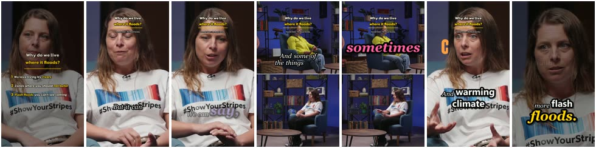

**[Second Short from the same interview · คลิปที่สองจากสัมภาษณ์เดียวกัน](https://github.com/phumrapee47/skills-video-editor/releases/download/test-results/short-batch-heat.mp4)** · 1.5 · 41 s

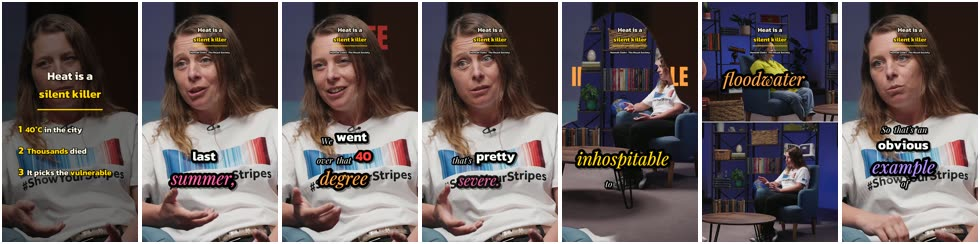

**[Two-shot that follows the speaker · ภาพสองคนที่ตามคนพูด](https://github.com/phumrapee47/skills-video-editor/releases/download/test-results/short-two-shot-follow.mp4)** · 1.6 · 21 s

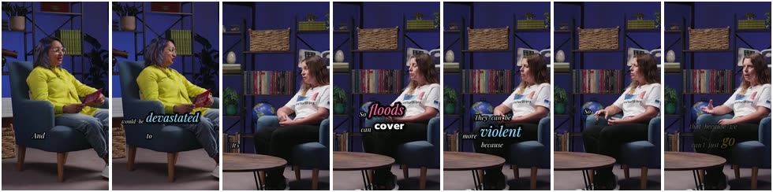

**[Thai word-stack captions · ซับไทยเรียงคำ](https://github.com/phumrapee47/skills-video-editor/releases/download/test-results/short-thai-word-stack.mp4)** · 1.6 · 30 s

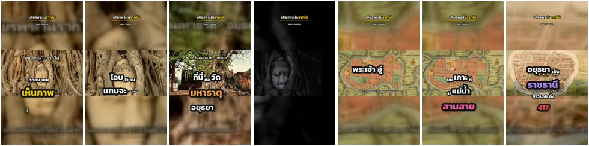

**[Brand kit (made-up Flood Lab) · brand kit แบรนด์สมมติ](https://github.com/phumrapee47/skills-video-editor/releases/download/test-results/short-brand-kit.mp4)** · 1.7 · 45 s

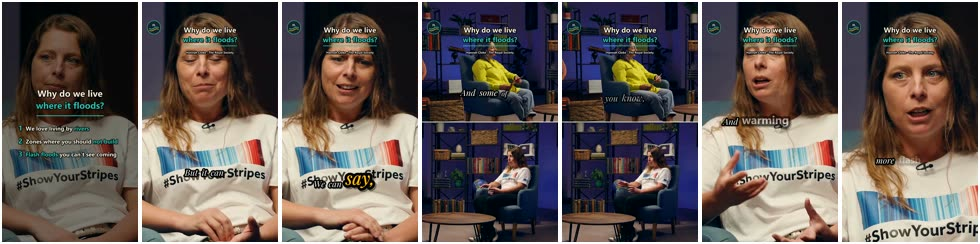

**[Screen tutorial with focus zooms · สอนหน้าจอพร้อมซูมจุดสำคัญ](https://github.com/phumrapee47/skills-video-editor/releases/download/test-results/tutorial-screen-focus.mp4)** · genre round 1 · 75 s

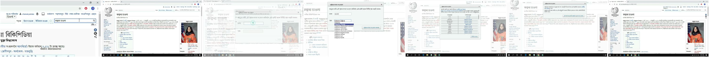

**[3D ad v1 · โฆษณา 3D v1](https://github.com/phumrapee47/skills-video-editor/releases/download/test-results/ad3d-luma-v1.mp4)** · 1.9 · 16 s

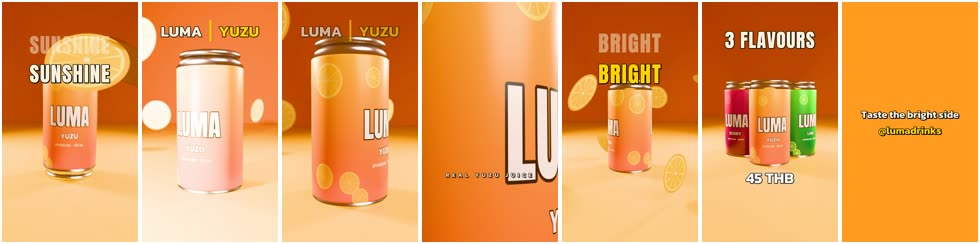

**[3D ad v2: real yuzu split · ผ่ายูซุ 3D จริง](https://github.com/phumrapee47/skills-video-editor/releases/download/test-results/ad3d-luma-v2.mp4)** · 1.9 · 17 s

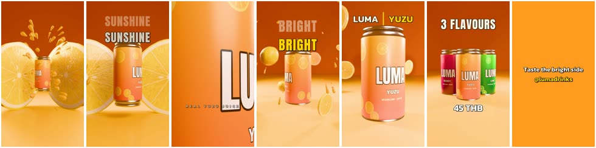

**[3D ad v3: the can opens · เปิดฝากระป๋อง](https://github.com/phumrapee47/skills-video-editor/releases/download/test-results/ad3d-luma-v3.mp4)** · 1.9 · 19 s

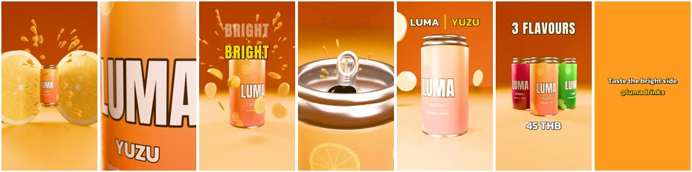

**[Through the approval gates · ผ่านขั้นอนุมัติ](https://github.com/phumrapee47/skills-video-editor/releases/download/test-results/ad3d-luma-pipeline.mp4)** · 1.10 · 18 s

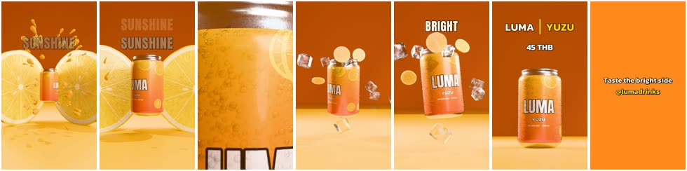

**[Design pass · ออกแบบก่อนสร้าง](https://github.com/phumrapee47/skills-video-editor/releases/download/test-results/ad3d-luma-design-pass.mp4)** · 1.12 · 18 s

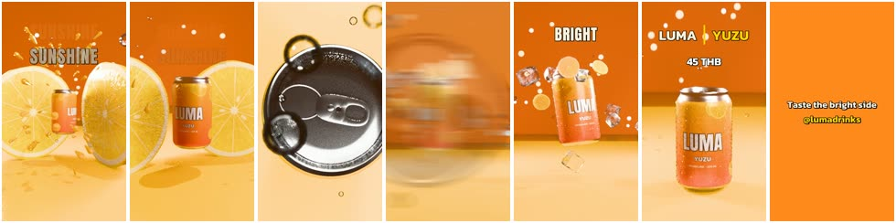

**[MOLTO bar snaps · ขนมแท่งหัก](https://github.com/phumrapee47/skills-video-editor/releases/download/test-results/ad3d-molto-bar-snap.mp4)** · 1.11 · 11 s

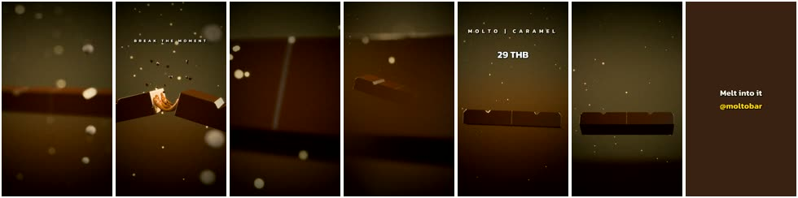

**[VOLT, tech mood · อารมณ์ tech](https://github.com/phumrapee47/skills-video-editor/releases/download/test-results/ad3d-volt-tech.mp4)** · 1.13 · 12 s

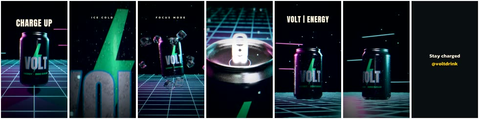

**[Performance ad with AI voiceover · โฆษณาขายของพร้อมเสียงพากย์](https://github.com/phumrapee47/skills-video-editor/releases/download/test-results/ad3d-luma-performance.mp4)** · 1.14 · 16 s

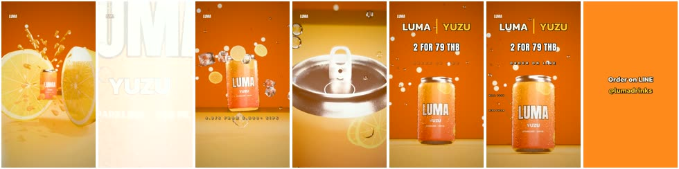

**[Blade, juice films, crown splash · ใบมีด แผ่นน้ำ มงกุฎน้ำ](https://github.com/phumrapee47/skills-video-editor/releases/download/test-results/ad3d-luma-crown.mp4)** · 1.15 · 16 s

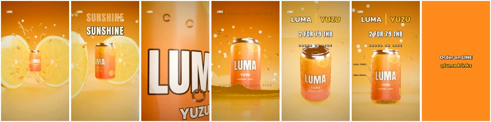
